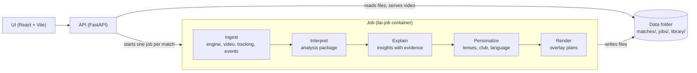

# tacticAI

tacticAI is Agentic Match Intelligence. Our own engine simulates football matches, every frame is analysed, each moment is explained with evidence that can be traced back to the data, and the same match is told differently for each audience, directly over the video. All data is synthetic and generated by us.

Built for the Microsoft Premier League Hackathon, "Inside the Game".

## What you can try

- **Watch**: a match video with overlays synchronised to the clock, a list of key moments and an evidence panel for each one (the numbers behind the claim).
- **Five lenses**: the same moments filtered and worded for different viewers: Analyst, Fan, First Match, Broadcast and One Metric. My Club (pick a side) personalises any of them.
- **Player Focus**: a player card with a goals-added rating and its breakdown, a heat map, and that player's moments (click to jump the video).
- **One Metric**: a strip under the video that follows a single metric over time, with gaps where there is no data.
- **Broadcast console**: the broadcast lens as a queue of on-air graphics.
- **Three lenses**: a split screen with one master video and two mirrors, each pane asking for its own overlays.
- **Ask for a play**: describe a situation in words, review the recipe, generate it and follow the progress live. The Scenario agent turns the text into a recipe and edits the current one.
- **Match library**: about 100 pre-searched situations without video, plus 5 with video; picking one only renders it.

Languages: English and Spanish.

## Architecture



The stages talk through files, not services: each one reads the previous stage's output and writes its own. The API is always on; the heavy work (the C++ engine and the pipeline) runs as one job per match in the `tai-job` container. A job writes into a staging folder and publishes the finished match with one rename, so the API never reads a half-written match. Failures are reported with a clear message and a person resolves them: there are no automatic retries.

Agents versus deterministic tools: everything that can be computed is computed by code (events, expected-goals and expected-pass models, pressure, team shape, phase detection, the goals-added rating, the importance score of a moment, the overlay timing). Agents are only for language: they choose and word, they never produce a number. The evidence rule: a number shown to a user comes from code and travels in the insight's evidence; an agent writes text with `{metric}` placeholders that the code fills in, and the only special claims it may make are the ones the code attached to the insight. Every agent plug point has a deterministic fallback (a template or a rule), so the whole application works without any model.

## Data contract

Ingest publishes one match package per match (`meta.json`, `roster.json`, `tracking.jsonl`, `events.jsonl`, `video.mp4`) and every later stage reads only that package, never the source that produced it, so a real-video source could replace the engine. Interpret writes an analysis package next to it.

## Run it locally

Requirements: Docker (the engine runs only inside Docker), Python 3.10 or newer, Node.js.

```sh
# 1. Images (once; the engine compiles and takes a while)
docker build -t tai-engine engine
docker build -f deploy/job.Dockerfile -t tai-job .

# 2. Python environment for the API and the tests
pip install -e ".[api,agents,dev]"

# 3. API on the host (it launches jobs in tai-job with docker run)
uvicorn tacticai.api.app:app --port 8000 --workers 1 --env-file .env --reload

# 4a. UI in development (Vite proxies to the API)
cd ui && npm install && npm run dev

# 4b. Or build the UI, which the API then serves at http://localhost:8000/
cd ui && npm install && npm run build
```

The `.env` file (git-ignored) holds `FOUNDRY_ENDPOINT`, `FOUNDRY_DEPLOYMENT` and `FOUNDRY_API_KEY` (optional: `FOUNDRY_JUDGE_DEPLOYMENT` for a different judge model, `FOUNDRY_REASONING_EFFORT` for reasoning models, default `low`). `TAI_ACCESS_KEY` is optional: when set, `/scenario`, `/ask` and `POST /jobs` need the header `X-Access-Key` (the UI takes it once from `?key=`). The agents read the `FOUNDRY_*` variables; without them every agent falls back to its template or rule, `/scenario` and `/ask` answer 501, and the rest of the app works the same.

Generate one match by hand (the engine needs `xvfb-run` wrapped in `sh -c`), then infer its events on the host:

```sh
docker run --rm -v <repo>/data:/data -v <repo>/src:/app/src --env-file .env tai-job sh -c "xvfb-run -a -s '-screen 0 1280x720x24' python3 -m tacticai.ingest generate --seed 1 --out /data/matches"
python -m tacticai.ingest events data/matches/<match_dir>
```

Run the pipeline stages on an existing match, or on all of them:

```sh
python -m tacticai.orchestration enrich <match_id>
python -m tacticai.orchestration enrich --all
python -m tacticai.orchestration refresh <match_id>     # recompute events and analysis in place
```

Build the match library: plan, then the entries without video, then video for the 5 demo entries.

```sh
python -m tacticai.orchestration library-plan
docker run --rm -v <repo>/data:/data -v <repo>/src:/app/src --env-file .env tai-job sh -c "python3 -m tacticai.orchestration library --plan /data/library_plan.json --workers 4"
docker run --rm -v <repo>/data:/data -v <repo>/src:/app/src --env-file .env tai-job sh -c "xvfb-run -a -s '-screen 0 1280x720x24' python3 -m tacticai.orchestration library-render --pick-demo"
```

Other entry points: `python -m tacticai.training --help` (datasets, model training, style measurement), `python -m tacticai.interpret analyze <match_dir>`, `python -m tacticai.explain build <match_dir>`, `python -m tacticai.personalize build <match_dir>`, `python -m tacticai.render plans <match_dir>`, and `python -m tacticai.interpret mcp` (serves the statistics tools over stdio MCP). Each command's `--help` lists its options.

## Tests

```sh
python -m pytest tests
```

The test suite covers ingest, interpret, explain, personalize, render, the job pipeline, the agents (with a fake model, no network) and the API; CI runs it on every push (`.github/workflows/ci.yml`). The UI is checked by `cd ui && npm run build` (type check) and `npm run lint`.

## Repository layout

| Path | What it holds |
| --- | --- |
| `src/tacticai/ingest/` | Stage 1: match factory around the engine, event inference, recipe search |
| `src/tacticai/interpret/` | Stage 2: analysis package, loading the expected-goals, expected-pass and goals-added models, tactical tools, statistics tools (MCP) |
| `src/tacticai/explain/` | Stage 3: insights with evidence and contextual importance |
| `src/tacticai/personalize/` | Stage 4: lenses, My Club, Player Focus, language variants, recaps |
| `src/tacticai/render/` | Stage 5: overlay plans and brand tokens |
| `src/tacticai/orchestration/` | The job pipeline, its progress files, the job launcher (Docker or Azure Container Apps Job) and the match library |
| `src/tacticai/core/` | File helpers shared by every stage |
| `src/tacticai/agents/` | Shared pieces of the LLM agents (each agent lives in its stage, next to its tools) |
| `src/tacticai/training/` | Offline work: synthetic datasets, model training, style measurement |
| `src/tacticai/api/` | FastAPI app and file serving |
| `ui/` | React + Vite interface |
| `engine/` | The C++ match engine and its Docker build |
| `deploy/`, `azure.yaml` | Dockerfiles, Bicep and the Azure Developer CLI project |
| `data/` | Generated matches, jobs and library (git-ignored) |
| `tests/` | pytest tests |

Deploy, volumes and the Azure resources: [deploy/README.md](deploy/README.md).

## Microsoft technologies

- **Microsoft Agent Framework:** every LLM agent (`agent-framework-core`, `agent-framework-openai`), with structured output and typed tools; the agents run in our Python backend.
- **Microsoft Foundry:** the model behind the agents, called with an API key.
- **Azure Container Apps:** the always-on API with the built UI.
- **Azure Container Apps Jobs:** one job per match runs the engine and the pipeline.
- **Azure Files:** the shared data folder mounted by the API and the job.
- **Azure Container Registry:** the API and job images, pulled with a managed identity.
- **Log Analytics and Application Insights:** container logs and API telemetry.
- **Cost Management budget:** email alerts on spend.
- **Bicep and the Azure Developer CLI (`azd`):** the whole deployment as code.

## Status

Built and working end to end:

- The engine, the job pipeline, the API and the UI, including the library, the lenses, Player Focus, One Metric, the Broadcast console and the three-lens split screen.
- The deterministic Interpret tools and the goals-added rating.
- Explain, Personalize and Render, with templates and rules as the fallback of every agent.
- Nine LLM agents on Microsoft Agent Framework with a Microsoft Foundry model: Scenario and Match Q&A in the API; Tactical Analyst, Explainer, Lens, Recap, Director, Translator and a Causal Judge in the job (one run each per match; Lens, Recap and Director in parallel). Agents write English once; the Translator produces Spanish. The Causal Judge rejects Tactical and Explainer texts that claim a cause the data does not show. Every text is validated by code and falls back to its template or rule when it fails. Without the `FOUNDRY_*` variables the app behaves exactly as with templates and rules only.

Azure: the Dockerfiles, Bicep and `azd` project exist, but nothing is deployed and none of the Azure behaviour has been run. Deployment is manual; see [deploy/README.md](deploy/README.md), which also lists what is unverified.

## License

Our own code is MIT-licensed, see [LICENSE](LICENSE). The engine is derived from open-source work, and the repository uses a font and some container tools; see [THIRD_PARTY_NOTICES.md](THIRD_PARTY_NOTICES.md).
