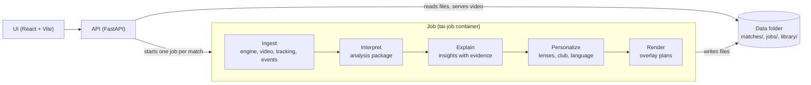

# tacticAI

[](https://youtu.be/bpkAspW27DM)

▶ [Watch the 2-minute demo on YouTube](https://youtu.be/bpkAspW27DM)

tacticAI is Agentic Match Intelligence. Our own engine simulates football matches, every frame is analysed, each moment is explained with evidence that can be traced back to the data, and the same match is told differently for each audience, directly over the video. All data is synthetic and generated by us.

Built for the Microsoft Premier League Hackathon, "Inside the Game".

## What you can try

- **Watch**: a match video with overlays synchronised to the clock, a list of key moments and an evidence panel for each one (the numbers behind the claim).
- **Three viewing modes**: the same match told for different viewers. Analyst shows every number with its evidence.
- **Fan mode**: the language (English or Spanish), My club (home, away or neutral) changes the stance of every comment, and My player follows one player with a live card, their lines and portraits. At full time, terrace awards. You can ask the match a question and get the answer in a supporter's voice.
- **Broadcast mode**: a machine-readable, timed rundown of on-screen graphics (goal, shot, pass quality, carry, milestone, player ID with thresholds), drawn as TV-style lower-thirds with player portraits, one graphic at a time, the most important first (goal, shot, pass, carry, milestone, player ID). A Clean feed / Plus feed switch, an on-air bar, a full-screen goal takeover that holds the frame for 3 s, and a full-time graphic. A Studio tab holds the presenter script (English or Spanish, with VT segments that cue the replay) and a Reels tab holds 9:16 clips of goals and shots, cut around the play with the lower-third burned in, in English and Spanish.
- **Player Focus**: a player card with a goals-added rating and its breakdown, a heat map, and that player's moments (click to jump the video).
- **Ask for a play**: describe a situation in words (typed or spoken), review the recipe, generate it and follow the progress live (the page shows "Starting the engine..." while the job container boots). The Scenario Agent turns the text into a recipe and edits the current one. The chat accepts a spoken request: speech-to-text with Azure AI Speech, from the same Azure AI Services resource as Foundry; the API issues a short-lived token at `GET /speech/token` so the key never reaches the browser, and English and Spanish are detected automatically.
- **Match library**: 104 pre-searched situations, 5 of them with video. `POST /jobs` first looks for an exact match of the request in the library and, if found, renders that entry instead of searching. Otherwise seeds are searched in batches, each with a fresh process pool (this bounds engine memory), and the search stops once 3 seeds meet every condition (full matches and recipes that only rank seeds, such as more pressure or more possession, try every seed and keep the best).

Languages: English and Spanish.

## Architecture



The stages talk through files, not services: each one reads the previous stage's output and writes its own. The API is always on; the heavy work (the C++ engine and the pipeline) runs as one job per match in the `tai-job` container. A job writes into a staging folder and publishes the finished match with one rename, so the API never reads a half-written match. Failures are reported with a clear message and a person resolves them: there are no automatic retries.

Events are inferred from the positions: passes, tackles, shots, goals and carries, including one-touch receptions and carries.

Agents versus deterministic tools: everything that can be computed is computed by code (events, expected-goals and expected-pass models, pressure, team shape, phase detection, the goals-added rating, the importance score of a moment, the overlay timing). Agents are only for language: they choose and word, they never produce a number. The evidence rule: a number shown to a user comes from code and travels in the insight's evidence; an agent writes text with `{metric}` placeholders that the code fills in, and the only special claims it may make are the ones the code attached to the insight. Every agent plug point has a deterministic fallback (a template or a rule), so the whole application works without any model. The review pattern is the same everywhere: code computes the facts, an agent writes, a deterministic contract check validates placeholders, claims and names, a judge agent reviews the text, a rejected text gets one revision, and what still fails falls back per item to its template, rule or a line of data.

## Data contract

Ingest publishes one match package per match (`meta.json`, `roster.json`, `tracking.jsonl`, `events.jsonl`, `video.mp4`) and every later stage reads only that package, never the source that produced it, so a real-video source could replace the engine. Interpret writes an analysis package next to it.

## Run it locally

Requirements: Docker (the engine runs only inside Docker), Python 3.10 or newer, Node.js.

```sh
# 1. Images (once; the engine compiles and takes a while)
docker build -t tai-engine engine
docker build -f deploy/job.Dockerfile -t tai-job .

# 2. Python environment for the API and the tests
pip install -e ".[api,agents,dev]"

# 3. API on the host (it launches jobs in tai-job with docker run)
uvicorn tacticai.api.app:app --port 8000 --workers 1 --env-file .env --reload

# 4a. UI in development (Vite proxies to the API)
cd ui && npm install && npm run dev

# 4b. Or build the UI, which the API then serves at http://localhost:8000/
cd ui && npm install && npm run build
```

The `.env` file (git-ignored) holds `FOUNDRY_ENDPOINT`, `FOUNDRY_DEPLOYMENT` and `FOUNDRY_API_KEY` (optional: `FOUNDRY_JUDGE_DEPLOYMENT` for a different judge model, `FOUNDRY_REASONING_EFFORT` for reasoning models, default `low`). `TAI_ACCESS_KEY` is optional: when set, `/scenario`, `/ask` and `POST /jobs` need the header `X-Access-Key` (the UI takes it once from `?key=`). The agents read the `FOUNDRY_*` variables; without them every agent falls back to its template or rule, `/scenario` and `/ask` answer 501, and the rest of the app works the same.

Generate one match by hand (the engine needs `xvfb-run` wrapped in `sh -c`), then infer its events on the host:

```sh
docker run --rm -v <repo>/data:/data -v <repo>/src:/app/src --env-file .env tai-job sh -c "xvfb-run -a -s '-screen 0 1280x720x24' python3 -m tacticai.ingest generate --seed 1 --out /data/matches"
python -m tacticai.ingest events data/matches/<match_dir>
```

Run the pipeline stages on an existing match, or on all of them:

```sh
python -m tacticai.orchestration enrich <match_id>
python -m tacticai.orchestration enrich --all
python -m tacticai.orchestration refresh <match_id>     # recompute events and analysis in place
```

Build the match library: plan, then the entries without video, then video for the 5 demo entries.

```sh
python -m tacticai.orchestration library-plan
docker run --rm -v <repo>/data:/data -v <repo>/src:/app/src --env-file .env tai-job sh -c "python3 -m tacticai.orchestration library --plan /data/library_plan.json --workers 4"
docker run --rm -v <repo>/data:/data -v <repo>/src:/app/src --env-file .env tai-job sh -c "xvfb-run -a -s '-screen 0 1280x720x24' python3 -m tacticai.orchestration library-render --pick-demo"
```

Other entry points: `python -m tacticai.training --help` (datasets, model training, style measurement), `python -m tacticai.interpret analyze <match_dir>`, `python -m tacticai.explain build <match_dir>`, `python -m tacticai.personalize build <match_dir>`, `python -m tacticai.render plans <match_dir>`, and `python -m tacticai.interpret mcp` (serves the statistics tools over stdio MCP). Each command's `--help` lists its options.

## Tests

```sh
python -m pytest tests
```

The test suite covers ingest, interpret, explain, personalize, render, the job pipeline, the agents (with a fake model, no network) and the API; CI runs it on every push (`.github/workflows/ci.yml`). The UI is checked by `cd ui && npm run build` (type check) and `npm run lint`.

## Repository layout

| Path | What it holds |
| --- | --- |
| `src/tacticai/ingest/` | Stage 1: match factory around the engine, event inference, recipe search |
| `src/tacticai/interpret/` | Stage 2: analysis package, loading the expected-goals, expected-pass and goals-added models, tactical tools, statistics tools (MCP) |
| `src/tacticai/explain/` | Stage 3: insights with evidence and contextual importance |
| `src/tacticai/personalize/` | Stage 4: lenses, My Club, Player Focus, language variants, recaps, the fan view and the Studio script |
| `src/tacticai/render/` | Stage 5: overlay plans, the broadcast rundown, reels and brand tokens |
| `src/tacticai/orchestration/` | The job pipeline, its progress files, the job launcher (Docker or Azure Container Apps Job) and the match library |
| `src/tacticai/core/` | File helpers shared by every stage |
| `src/tacticai/agents/` | Shared pieces of the LLM agents (each agent lives in its stage, next to its tools) |
| `src/tacticai/training/` | Offline work: synthetic datasets, model training, style measurement |
| `src/tacticai/api/` | FastAPI app and file serving |
| `ui/` | React + Vite interface |
| `engine/` | The C++ match engine and its Docker build |
| `deploy/`, `azure.yaml` | Dockerfiles, Bicep and the Azure Developer CLI project |
| `data/` | Generated matches, jobs and library (git-ignored) |
| `tests/` | pytest tests |

Deploy, volumes and the Azure resources: [deploy/README.md](deploy/README.md).

## Microsoft technologies

- **Microsoft Agent Framework:** every LLM agent (`agent-framework-core`, `agent-framework-openai`), with structured output and typed tools; the agents run in our Python backend.
- **Microsoft Foundry:** the model behind the agents (deployment `gpt-5-mini`), called with an API key.
- **Azure AI Speech:** speech-to-text for the spoken request in New Match, from the same Azure AI Services resource as Foundry, with a short-lived token issued by the API.
- **Azure Container Apps:** the always-on API with the built UI.
- **Azure Container Apps Jobs:** one job per match runs the engine and the pipeline.
- **Azure Files:** the shared data folder mounted by the API and the job.
- **Azure Container Registry:** the API and job images, pulled with a managed identity.
- **Log Analytics and Application Insights:** container logs and API telemetry.
- **Cost Management budget:** email alerts on spend.
- **Bicep and the Azure Developer CLI (`azd`):** the whole deployment as code.

## Status

Built and working end to end:

- The engine, the job pipeline, the API and the UI, including the library, the Analyst, Fan and Broadcast modes, Player Focus, the broadcast rundown, the Studio script, reels and spoken requests.
- The deterministic Interpret tools and the goals-added rating.
- Explain, Personalize and Render, with templates and rules as the fallback of every agent.
- Twelve LLM agents on Microsoft Agent Framework with a Microsoft Foundry model (`gpt-5-mini`): Scenario Agent and Match Q&A in the API; Tactical Analyst, Explainer, Causal Judge, Lens Agent, Recap Agent, Translator, Director, Supporter Agent, Fan Judge and Studio Script Agent in the job. Agents write English once and the Translator produces Spanish. The Causal Judge rejects Tactical and Explainer texts that claim a cause the data does not show. The fan view is written per language and club: code detects what a supporter lives and decides what each club's supporter feels about it, the Supporter Agent writes it in that supporter's voice (including a line per moment for a reader who follows one player), and the Fan Judge checks every text against one rubric; rejected texts go back once with the judge's reasons. The Studio Script Agent writes the full-time presenter script. Every text is validated by code and falls back to its template, rule or a line of data when it fails. Without the `FOUNDRY_*` variables the app behaves exactly as with templates and rules only.

Azure: the Dockerfiles, Bicep and `azd` project exist, but nothing is deployed and none of the Azure behaviour has been run. Deployment is manual; see [deploy/README.md](deploy/README.md), which also lists what is unverified.

## License

Our own code is MIT-licensed, see [LICENSE](LICENSE). The engine is derived from open-source work, and the repository uses a font and some container tools; see [THIRD_PARTY_NOTICES.md](THIRD_PARTY_NOTICES.md).
